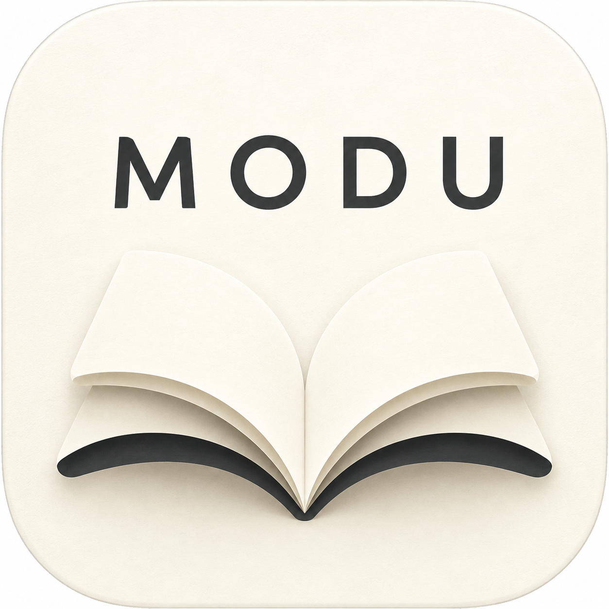

  

<h1 align="center">默读 · Modu Reader</h1>

  <a href="README.md">简体中文</a> · <a href="README_EN.md">English</a>

开源、跨平台的阅读器。整理书库，专注阅读，用标注、翻译、听书和 AI 读懂每一本书。

  
  
  

  <a href="https://github.com/sobranie2406/modureader/releases/latest"><b>下载最新版</b></a> ·
  <a href="https://gitee.com/sobranie2406/modureader/releases">Gitee 镜像</a> ·
  <a href="#features">功能一览</a> ·
  <a href="docs/SETTINGS_zh.md">设置指南</a> ·
  <a href="docs/README.md">文档目录</a> ·
  <a href="https://t.me/Modureader">Telegram 频道</a> ·
  <a href="https://t.me/ModuReaderDiscussion">Telegram 讨论群</a> ·
  <a href="https://github.com/sobranie2406/modureader/issues">问题反馈</a>

支持 Android、iOS、macOS、Windows、Linux 与原生鸿蒙。本地阅读无需 AI 账号，在线功能按需选用。

## 下载与文档

[下载最新版](https://github.com/sobranie2406/modureader/releases/latest) · [Gitee 镜像](https://gitee.com/sobranie2406/modureader/releases) · [安装指南](docs/RELEASING.md) · [更新记录](docs/RELEASE_NOTES.md)

[功能说明](docs/FEATURES_zh.md) · [设置指南](docs/SETTINGS_zh.md) · [全部文档](docs/README.md) · [示例电子书](docs/examples/modu-reading-demo.epub)

## 功能一览

多格式书库、自由排版、扫描书重排、AI 阅读、翻译听书，以及跨设备同步。日常阅读需要的工具，都在书页身边。

### PDF 与扫描书

保留原书版式，自动裁去多余留白。分格阅读、旋转缩放与图像增强，让扫描书在小屏幕上也能看清细节。

### 离线文字识别

把扫描页变成可排版、可选词的文字，继续翻译、标注、记笔记。轻量 OCR 模型在设备上运行，下载后即可离线使用。

### 原页与文字对照

原版书页和重排文字同屏阅读，兼顾版式与清晰度。手机上下对照，横屏左右对照，查阅原文更方便。

### 微信读书资料

为本地书籍关联封面、简介、出版信息和评分。看看读者书评与热门划线，为阅读多添一个视角。

### 书库管理

支持 EPUB、PDF、MOBI、AZW3、FB2、TXT、Markdown 和文字 UMD。用文件夹、筛选、排序与置顶整理书库，批量导入或从 WebDAV 远程书库下载，也能迁移 ANX Reader 备份。

### 自由排版

字体、粗细、间距、页边距，都能调成喜欢的样子。支持翻页与滚动、浅色与深色主题，以及 OLED、墨水屏模式。

#### 竖排阅读

切换竖排，搭配边框与栏线，找回传统书页的阅读节奏。

### 自定义阅读样式

从预设和图形调节开始，也可以用 CSS 精细调整。对白配色、关键词高亮、多套样式切换，让不同的书有自己的样子。

### 逐段翻译

语种翻译与文言文／现代汉语互译分别设置，翻译可见段落，逐段呈现，可随时停止。选择仅译文或原文对照，并单独调整译文字体、字号、粗体与斜体，不改变原文排版。

### 听书

支持系统朗读、Edge TTS、小米 MiMo、OpenAI 兼容服务和 DashScope。语速支持 0.1～4.0 倍、每次 0.1，可直接输入；安卓 MiMo 支持本地音调调整。选择音色，搭配支持的声音风格描述，让故事用喜欢的声音继续；普通文字书支持跨章续读和朗读高亮。

### AI 阅读

解释选文、总结章节、梳理论证、追踪人物，或生成思维导图。接入自己的 AI 服务，自定义阅读技能，围绕书中内容继续追问。

### 划词工具

选中文字，就能复制、标注、翻译、查询或交给 AI。工具按钮自由排序，常用命令随手可用。

### 综合查询

在「综合」页查看字典释义、选词翻译和 AI 知识，不用离开书页。支持导入 MDX、StarDict 词典离线查词，翻译与 AI 来源按需配置。

### 高亮与笔记

标记喜欢的句子，写下当时的想法。按书籍和章节回顾笔记，导出 Markdown、TXT 或 CSV，也能从笔记链接回到原文。

### 阅读记录

用时长趋势、热力图和打卡目标记录阅读习惯。查看最近阅读、单本书进度与多轮阅读记录，看见日积月累的收获。

### 跨设备同步

通过自己的 WebDAV 或 S3 兼容存储，同步书籍、笔记、书签和阅读位置。换一台设备，接着读，也能接着听。

### 备份与迁移

用书库备份保存书籍和阅读记录，用设置备份带走排版、CSS、AI 技能与常用工具。换机时，把书和习惯一起带走。

## 交流与反馈

[Telegram 频道](https://t.me/Modureader) · [Telegram 讨论群](https://t.me/ModuReaderDiscussion) · **QQ 交流群：1009765685**

提交 Bug 或功能建议：[GitHub Issues](https://github.com/sobranie2406/modureader/issues/new/choose) · [在线反馈表](https://docs.qq.com/smartsheet/form/dxaiuhjrhCar%2Ft00i2h%2FvI8Bvs?tab=t00i2h)

## 参与项目

欢迎提交问题、改进代码或完善文档。如果默读对你有帮助，也欢迎点一个 Star。

[参与贡献](CONTRIBUTING_zh.md) · [构建与打包](docs/RELEASING.md) · [隐私说明](PRIVACY_zh.md) · [安全报告](SECURITY_zh.md)

<a href="https://www.star-history.com/?repos=sobranie2406%2Fmodureader&amp;type=date&amp;legend=top-left">
  <picture>
    <source media="(prefers-color-scheme: dark)" srcset="https://api.star-history.com/chart?repos=sobranie2406%2Fmodureader&amp;type=date&amp;theme=dark&amp;legend=top-left" />
    <source media="(prefers-color-scheme: light)" srcset="https://api.star-history.com/chart?repos=sobranie2406%2Fmodureader&amp;type=date&amp;legend=top-left" />
    
  </picture>
</a>

## 开源许可

默读按 **GPL-3.0-or-later** 发布，基于 Anx Reader，并包含 ReadAny 的相关代码。原项目的版权与许可均予以保留。

[项目许可](LICENSE) · [Anx Reader 许可](LICENSES/Anx-Reader-MIT.txt) · [ReadAny 许可](LICENSES/ReadAny-GPL-3.0-or-later.txt) · [上游与修改说明](UPSTREAM.md) · [第三方声明](NOTICE)

## 1.3.6 更新

Mac 通用版与 Windows 统一安装包兼容旧版自动更新；支持书中图片连续浏览、文字／整段过滤、重排 CSS 和点击翻页，恢复 PDF 滑动翻页，并改进阅读同步提示、字典资源导入及鸿蒙书架兼容。
